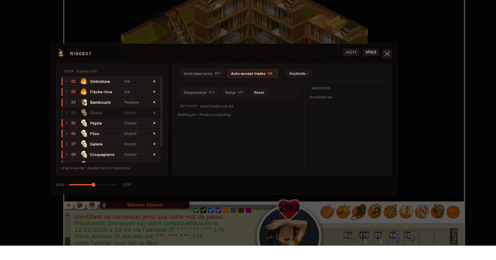
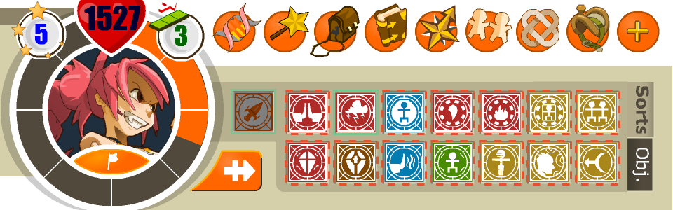
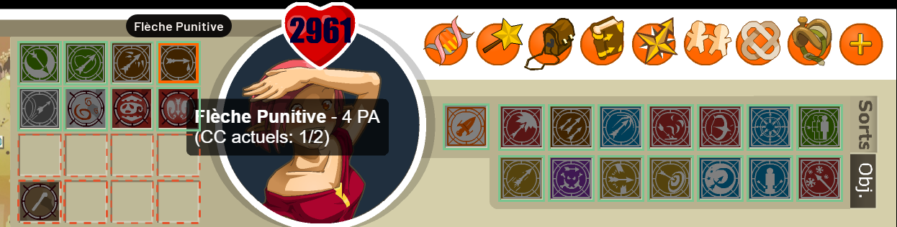
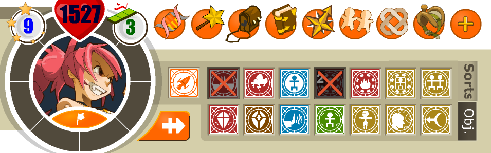

  

  
  
  
  
  
  

# Minobot

Un logiciel de confort pour **Dofus Retro**, pour les joueurs multi-comptes. Il ne joue pas à votre
place : il reste en fond (icône à côté de l'horloge) et vous évite les manipulations répétitives.

<table>
  <tr>
    <td align="center">
       
      <b>L'overlay</b> (<code>Shift+Espace</code>) — la team dans votre ordre, les interrupteurs, l'activité et les messages privés
    </td>
  </tr>
</table>

## Fonctions

| Touche | Ce qu'elle fait |
| --- | --- |
| `Bouton latéral 1` | **Tous vos personnages cliquent au même endroit** que vous, sans que la fenêtre principale perde le focus. |
| `Shift+Bouton latéral 1` | Éteint le clignotement orange des fenêtres dans la barre des tâches. |
| `F8` | **Groupe toute la team** : chacun invite le suivant, qui accepte. |
| `Bouton latéral 2` / `Shift+Bouton latéral 2` | Passe au personnage suivant / précédent, dans votre ordre, sur l'écran courant. |
| `F9` | Remet les fenêtres dans l'ordre dans la barre des tâches (elles disparaissent un instant, c'est normal). |
| `Shift+Espace` | Ouvre / ferme l'overlay. |
| `Shift+clic molette` | Active / coupe **Auto-pass turns**. |

Et automatiquement :

- **Chaque fenêtre ouverte depuis le launcher passe en plein écran** (agrandie) dès son apparition, une
  seule fois : si vous la remettez ensuite en petite fenêtre, Minobot n'y touche plus.
- **Le bon personnage revient à l'écran** quand c'est son tour en combat, ou quand on lui propose un
  groupe, un échange ou un défi.
- **Auto-accept trades** (activé par défaut) : un échange proposé par un de vos propres personnages est
  accepté tout seul. Celui d'un autre joueur ne l'est jamais.
- **Auto-pass turns** (désactivé par défaut) : passe le tour de **tous** vos personnages. Une pastille
  orange reste affichée tant que c'est actif ; son bouton « Turn off » coupe la fonction.
- **Les messages privés** s'affichent dans une petite carte au lieu de vous faire changer de fenêtre ;
  cliquez dessus pour aller sur le personnage concerné.

## Installation

1. Téléchargez `Minobot-x.y.z.zip` depuis la
   [page des versions](https://github.com/Celldwaller/minobot/releases/latest) et décompressez-le où
   vous voulez.
2. Lancez **`Minobot.exe`**. Rien d'autre à installer.
3. **Activez les notifications Windows** du jeu pour recevoir les messages privés en carte (elles
   peuvent être silencieuses, en cochant `Masquer le contenu...`). C'est leur seul usage.

<table>
  <tr>
    <td align="center" width="50%">
       
      <b>Système › Notifications</b> — activez les notifications, puis ouvrez celles du jeu
    </td>
    <td align="center" width="50%">
       
      <b>Notifications du jeu</b> — activées, avec « Masquer le contenu » pour qu'elles restent discrètes
    </td>
  </tr>
</table>

> Si Windows affiche « Windows a protégé votre ordinateur », cliquez sur **Informations
> complémentaires** puis **Exécuter quand même**.

Pour quitter : clic droit sur l'icône à côté de l'horloge → **Quitter**.

## L'overlay (`Shift+Espace`, sur une fenêtre de jeu)

- **Vos personnages** : glissez une ligne pour changer l'ordre (utilisé par `Bouton latéral 2` et `F9`). Cliquez sur
  « Pick a class » (ou double-cliquez la ligne) pour choisir classe et sexe. Un personnage configuré reste
  dans la liste même déconnecté ; la petite croix le retire.
- **Les interrupteurs** Auto-pass turns et Auto-accept trades.
- **L'encadré Easyconome** : **Easyconome**, **Setup** et **Reset** (voir ci-dessous).
- **ACTIVITY** et **WHISPERS** : ce que Minobot vient de faire, et les messages privés reçus.
- **Keybinds ›** : cliquez sur une touche puis appuyez sur la nouvelle. Les lettres et chiffres sont
  refusés (ce sont les touches du chat).
- Un curseur en bas règle la taille du panneau.

L'ordre, les classes et les touches sont retenus ; la taille et les interrupteurs repartent de zéro au
redémarrage.

## Easyconome (challenge Économe)

Minobot lit le journal de combat dans le chat et **barre, sur la barre de sorts, chaque sort que le
personnage à l'écran a déjà lancé** dans ce combat, arme comprise.

1. Dans l'overlay, activez **Setup**. Sur chaque personnage, **cliquez un sort de la barre, puis
   lancez-le** dans les 10 secondes : la case passe au vert, et son nom s'affiche au survol.
2. Coupez **Setup** et activez **Easyconome**.

<table>
  <tr>
    <td align="center" width="50%">
       
      <b>Setup</b> — en vert les cases apprises, en pointillés rouges celles qui restent
    </td>
    <td align="center" width="50%">
       
      <b>Setup terminé</b> (affichage 16:9) — le nom du sort s'affiche au survol
    </td>
  </tr>
  <tr>
    <td align="center" colspan="2">
       
      <b>En combat</b> — les sorts déjà lancés sont barrés
    </td>
  </tr>
</table>

Les cases apprises valent pour **toute la classe** et sont retenues dans `spell-layouts.json`. Si un
personnage range ses sorts autrement que les autres de sa classe, le bouton **Own layout**, affiché
pendant le réglage, lui donne une disposition à lui (il faut lui avoir choisi une classe).

- Un **échec critique** ne compte pas : le sort peut être relancé.
- Un sort relancé est signalé dans ACTIVITY : « Easyconome: challenge lost ».
- Les croix s'effacent d'elles-mêmes quand le chat annonce « Combat terminé » ; **Reset** les efface à la
  main si cette ligne n'a pas été lue.
- Le chat est lu dans la fenêtre du **premier personnage de votre ordre** : il doit être dans le combat,
  avec les messages de combat affichés dans son chat.
- L'affichage 16:9 du jeu est reconnu, fenêtre par fenêtre : chat à gauche ou à droite, clair ou sombre,
  sorts en grille ou en colonne.

## Réglages avancés (`config.json`)

Créé à côté de `Minobot.exe` au premier lancement. Relancez Minobot après modification.

| Réglage | Rôle |
| --- | --- |
| `multiclick_exclude` | Personnages exclus du clic multiple, ex. `["Marchand"]`. |
| `auto_accept_trade` / `auto_pass_turn` | État des interrupteurs au démarrage. |
| `log_level` | `"DEBUG"` pour un journal détaillé. |

## En cas de problème

Le journal est dans **`logs/minobot.log`**, à côté de `Minobot.exe` : joignez-le si vous signalez un
souci. Une touche qui ne répond plus se réattribue dans le tiroir Keybinds.
